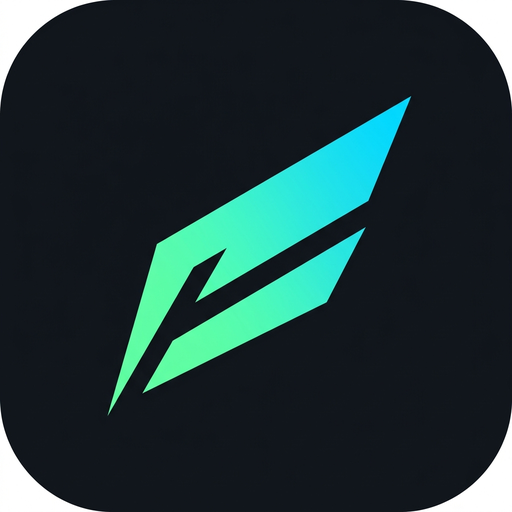
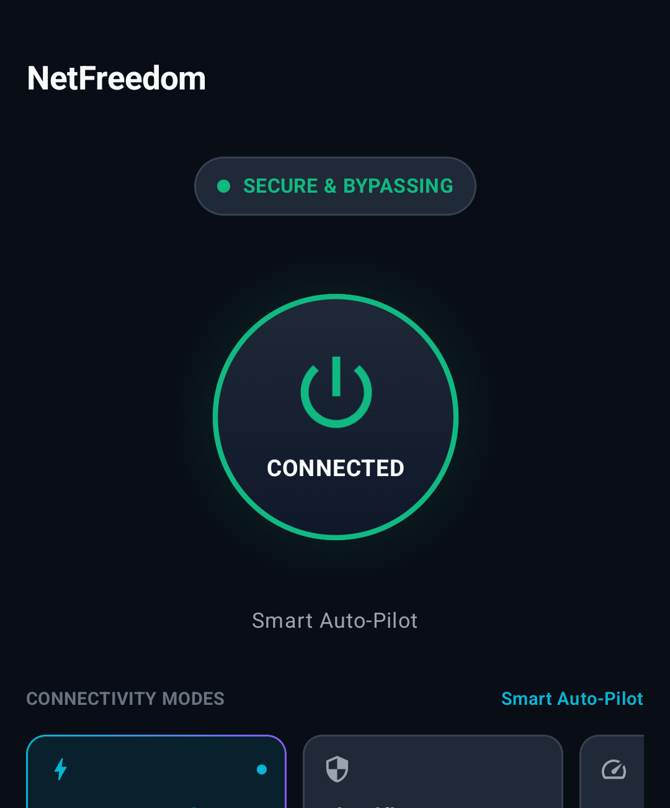

# NetFreedom

<div align="center">



### Next-Generation Multi-Mode Privacy, Security & Anti-Censorship Platform

[](https://github.com/AdityaPatra-dev/NetFreedom/releases/latest)
[](https://github.com/AdityaPatra-dev/NetFreedom/actions/workflows/ci.yml)
[](https://opensource.org/licenses/MIT)
[](https://www.rust-lang.org)
[](https://developer.android.com)
[](https://github.com/AdityaPatra-dev/NetFreedom)

*Engineered specifically for hostile enterprise and campus Wi-Fi networks: middlebox Deep Packet Inspection (DPI), Cisco firewalls, dead dual-stack IPv6 routes, DNS tampering, and ICMP blackholes.*

[**Downloads**](#-downloads--releases) • [**Features**](#-key-features) • [**Modes & Priority**](#-connectivity-modes--decision-guide) • [**Privacy FAQ**](#-campus-wi-fi--privacy-faq) • [**Quick Start**](#-quick-start)

</div>

---

## 📸 Visual Showcase

<div align="center">
  <table>
    <tr>
      <td align="center" width="50%">
        <b>📱 NetFreedom Android App (Active VPN)</b><br/><br/>
        
      </td>
      <td align="center" width="50%">
        <b>⚡ Verified Unblocking (`en-thunderscans.com`)</b><br/><br/>
        
      </td>
    </tr>
  </table>
</div>

---

## 📦 Downloads & Releases

Latest multi-platform binaries are published under [**Releases (v1.0.0)**](https://github.com/AdityaPatra-dev/NetFreedom/releases/latest).

### 📱 Android APKs
| Variant | Target Architecture | Description |
|---|---|---|
| **[`NetFreedom-v1.0.0-universal.apk`](https://github.com/AdityaPatra-dev/NetFreedom/releases/latest)** | **All Architectures (Fat APK)** | **Recommended.** Contains all 4 native engines (`arm64-v8a`, `armeabi-v7a`, `x86_64`, `x86`). |
| **`NetFreedom-v1.0.0-arm64-v8a.apk`** | 64-bit ARM | Lightweight standalone build for modern Android smartphones (2016+). |
| **`NetFreedom-v1.0.0-armeabi-v7a.apk`** | 32-bit ARM | Standalone build for older 32-bit phones and wearables. |
| **`NetFreedom-v1.0.0-x86_64.apk`** | 64-bit x86 | Optimized for ChromeOS, Android-x86, and modern emulators. |
| **`NetFreedom-v1.0.0-x86.apk`** | 32-bit x86 | Optimized for legacy 32-bit emulators. |

### 💻 Desktop & Apple
- **🐧 Linux (x86_64)**: [`netfreedom-v1.0.0-linux-x86_64.tar.gz`](https://github.com/AdityaPatra-dev/NetFreedom/releases/latest) (CLI, daemon, GNOME/KDE GUI, systemd service, polkit policies).
- **🪟 Windows (x86_64)**: [`netfreedom-v1.0.0-windows-x86_64.zip`](https://github.com/AdityaPatra-dev/NetFreedom/releases/latest) (CLI, daemon, signed `wintun.dll` driver, PowerShell installer).
- **🍏 Apple (iOS & macOS)**: [`NetFreedom-Apple-HevSocks5Tunnel.xcframework.zip`](https://github.com/AdityaPatra-dev/NetFreedom/releases/latest) & `ciadpi-macos-universal`.

---

## ✨ Key Features

1. **Serverless & Completely Zero-Cost**:
   - Unlike commercial VPNs that route all your traffic through expensive central servers, NetFreedom's **ByeDPI** mode runs 100% locally on your device.
   - You get your full direct internet bandwidth with zero subscription costs and zero bandwidth caps.
2. **Absolute Privacy & Zero Logging**:
   - No proxy provider or third party can log your browsing history or traffic. Everything is processed directly on your hardware.
3. **Built-in Fake-IP Remote DNS (`mapdns`)**:
   - Integrated `198.18.0.2` fake-IP domain resolver routes DNS queries directly through the proxy via domain names.
   - Completely stops DNS leaks to campus firewalls and eliminates timeouts caused by broken IPv6 (`AAAA`) routes.
4. **Adaptive Multi-Mode Routing**:
   - Seamlessly toggle or auto-pilot between **ByeDPI Desync**, **Cloudflare WARP**, and **Super-Stealth Hybrid**.
5. **Fail-Safe Hardware Killswitch**:
   - OS-level packet filtering (`nftables` on Linux, WFP on Windows) prevents accidental IP/data leakage if the tunnel disconnects.
6. **Live Telemetry & Diagnostics**:
   - Real-time download/upload rate monitors, TCP SYN/ACK handshake latency probes (works even when ICMP `ping` is blocked), and DPI middlebox diagnosis.

---

## 🔀 Connectivity Modes & Decision Guide

| Priority | Mode | Technology | Best Used For | Speed | College Admin Visibility |
| :---: | :--- | :--- | :--- | :---: | :---: |
| **#1** | **Smart Auto-Pilot** | Adaptive Telemetry Probe | Daily default browsing | Maximum | High |
| **#2** | **ByeDPI Desync** | Serverless TCP/TLS Desync (`ciadpi`) | 4K Streaming, Downloads, Gaming | Fastest (Direct) | Medium |
| **#3** | **Cloudflare WARP** | WireGuard (`boringtun`) | Maximum Privacy, IP-based bans | Fast | Maximum (Full Encryption) |
| **#4** | **Hybrid Mode** | ByeDPI + WARP Chaining | Hostile networks blocking VPNs | Moderate | Maximum (Full Encryption) |

### When to Use Which?
- **Everyday Browsing & Streaming**: Leave it on **Smart Auto-Pilot**. It tests your connection and automatically picks the most lightweight, lowest-latency method.
- **Max Speed / Direct Video**: Use **ByeDPI Desync**. Zero proxy servers, direct connection, zero ping overhead.
- **Strict Privacy from Admins**: Use **Cloudflare WARP**. All packets (DNS + Data) are fully encrypted inside WireGuard.
- **VPNs Blocked by Firewall**: Use **Hybrid Mode**. Cleaves the WireGuard handshake using DPI desynchronization before tunneling.

---

## 🛡️ Campus Wi-Fi & Privacy FAQ

### *Will my college or ISP know which websites I visit?*

It depends on the mode you select:

1. **In Cloudflare WARP Mode (or Hybrid Mode):**
   - **No.** All traffic, including domain lookups and web pages, is encrypted inside a WireGuard tunnel.
   - **What the college sees:** Only encrypted UDP packets addressed to Cloudflare Anycast servers. They cannot see website domain names, URLs, or data.

2. **In ByeDPI Desync Mode:**
   - **Page Contents & Passwords:** **100% Private.** Standard HTTPS encryption secures all passwords, cookies, and page paths.
   - **DNS Queries:** **Hidden.** NetFreedom uses built-in **`mapdns` fake-IP resolution**, preventing plaintext DNS queries from reaching college resolvers.
   - **Destination IP:** The connection travels directly to the website's hosting IP address. An administrator running manual deep forensic analysis could match destination IPs with public domain registries.

> [!TIP]
> If your primary goal is **speed and bypassing blocked sites**, use **ByeDPI**.  
> If your primary goal is **preventing the college network admin from seeing your destinations**, use **WARP Mode**.

---

## 🚀 Quick Start

### 📱 Android
1. Download **`NetFreedom-v1.0.0-universal.apk`** from [Releases](https://github.com/AdityaPatra-dev/NetFreedom/releases/latest).
2. Install the APK on your Android device (Android 8.0+ / API 26–35 supported).
3. Open the app, grant the standard Android `VpnService` permission, and tap **CONNECT**.

### 🐧 Linux

#### Option A: Desktop GUI
```bash
# Clone and install dependencies
git clone --recursive https://github.com/AdityaPatra-dev/NetFreedom.git
cd NetFreedom/apps/desktop
npm install

# Start the desktop GUI & background bridge
python3 server.py &
npm run tauri dev
```

#### Option B: Unified CLI
```bash
# Build release binaries
cargo build --release -p netfreedom-cli -p netfreedom-daemon

# Run Smart Auto-Pilot
sudo ./target/release/netfreedom auto

# Or start ByeDPI desynchronization directly
sudo ./target/release/netfreedom dpi start --split-pos 2+s --ttl 3

# Run network diagnostics
./target/release/netfreedom diag
```

### 🪟 Windows
1. Download `netfreedom-v1.0.0-windows-x86_64.zip`.
2. Extract the archive and launch PowerShell as Administrator:
   ```powershell
   .\scripts\install-windows.ps1
   netfreedom auto
   ```

---

## 🏗️ Architecture & Core Components

Rather than reinventing low-level networking primitives, NetFreedom orchestrates battle-tested, audit-grade upstream components:

```
                  ┌─────────────────────────────────────────┐
                  │       User Applications / Browsers       │
                  └────────────────────┬────────────────────┘
                                       │
                        TUN Device (Double /1 Route)
                                       ▼
                  ┌─────────────────────────────────────────┐
                  │   hev-socks5-tunnel (lwIP C Coroutines)  │
                  │       ├── Built-in mapdns (198.18.0.2)  │
                  │       └── Socks5 TCP/UDP Relay Engine   │
                  └────────────────────┬────────────────────┘
                                       │ SOCKS5 Interface
                                       ▼
       ┌───────────────────────────────┴───────────────────────────────┐
       ▼                                                               ▼
┌──────────────────────────────┐                       ┌──────────────────────────────┐
│        byedpi (ciadpi)       │                       │     boringtun (WireGuard)    │
│  - TCP/TLS Desynchronization │                       │  - Userspace WireGuard Engine│
│  - SNI Split & Spoofed TTL   │                       │  - Cloudflare WARP Edge      │
│  - Out-of-Order Packet Disp. │                       │  - End-to-End Encryption     │
└──────────────┬───────────────┘                       └──────────────┬───────────────┘
               │                                                      │
               ▼                                                      ▼
   Hostile Network / Firewall                             Encrypted WireGuard UDP
  (Cisco Middlebox / Deep Packet)                       (Protected against inspection)
```

- **DPI Desync Engine**: [hufrea/byedpi](https://github.com/hufrea/byedpi) (`ciadpi` C99 coroutine daemon).
- **TUN-to-SOCKS5 Bridge**: [heiher/hev-socks5-tunnel](https://github.com/heiher/hev-socks5-tunnel) with embedded lwIP stack.
- **WireGuard Core**: [cloudflare/boringtun](https://github.com/cloudflare/boringtun) (pure Rust, memory-safe WireGuard implementation).
- **Windows Kernel TUN**: [wintun](https://www.wintun.net/) (official signed high-performance Windows driver).
- **Desktop Shell**: [tauri](https://github.com/tauri-apps/tauri) v2 + React 19 + TypeScript + Tailwind CSS.
- **Android Shell**: Android `VpnService` + JNI bindings + Jetpack Compose (Material 3).

---

## 🧪 Testing & Verification

Run the automated leak verification suite:
```bash
./scripts/test-leak-switch.sh
```

Run all workspace Rust unit and integration tests:
```bash
cargo test --workspace --all-targets
```

---

## 📄 License

This project is licensed under the [MIT License](LICENSE).  
Upstream submodules retain their respective open-source licenses:
- `byedpi`: MIT License
- `hev-socks5-tunnel`: MIT License
- `boringtun`: 3-Clause BSD License
- `wintun`: MIT License
