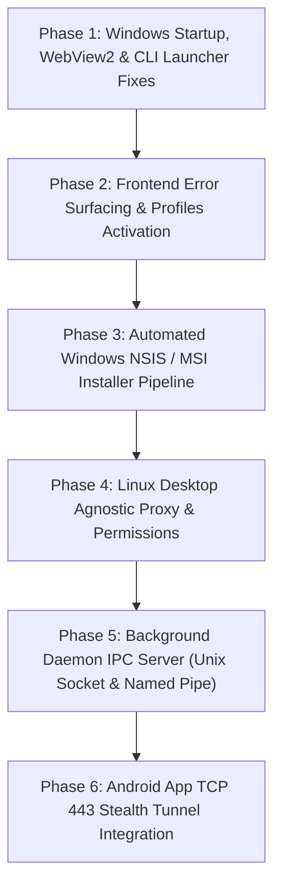

# NetFreedom Universal Cross-Platform Flaw Remediation Plan

## Executive Summary
This engineering remediation plan details the end-to-end implementation to eliminate all audited flaws across **Windows, Linux, Android, and macOS** in NetFreedom. It ensures that the application delivers a frictionless user experience: no silent crashes, no unextracted-zip traps, visible user-facing error feedback, seamless installation wizards with WebView2 auto-provisioning, unified mobile TCP 443 bypass, and daemon IPC communication.

---

## Architecture Flow of the Remediation Phases



---

## Phase 1: Windows Startup, WebView2 & CLI Launcher Fixes (Solves Auto-Close & Crash on Double-Click)

### 1.1 Root Cause & Target Defect
* When users double-click `netfreedom.exe` from Windows Explorer, Windows opens a command prompt window, runs the diagnostic probe, and immediately closes the window when the process exits.
* If Microsoft Edge WebView2 is absent or corrupted on a user's Windows machine, the Tauri desktop binary crashes on startup silently without a visible window or dialog.

### 1.2 Engineering Implementation Steps

#### A. Interactive CLI Smart Launcher (`crates/netfreedom-cli/src/main.rs`)
1. Detect whether `netfreedom.exe` was launched from an interactive terminal (CMD / PowerShell) or directly double-clicked from Windows Explorer:
   ```rust
   #[cfg(target_os = "windows")]
   fn is_launched_from_explorer() -> bool {
       unsafe {
           let mut pids = [0u32; 2];
           let count = winapi_or_custom_get_console_process_list(&mut pids);
           count <= 1
       }
   }
   ```
2. If `args.len() <= 1` and launched from Windows Explorer:
   - Check if `NetFreedom-GUI.exe` is present in the same directory.
   - If present, spawn `NetFreedom-GUI.exe` and exit cleanly:
     ```rust
     let gui_path = exe_dir.join("NetFreedom-GUI.exe");
     if gui_path.exists() {
         let _ = std::process::Command::new(gui_path).spawn();
         return Ok(());
     }
     ```
   - If GUI is absent, display an interactive text menu with options:
     `[1] Connect Auto-Pilot (DPI Desync) | [2] Connect Stealth Tunnel | [3] Disconnect | [4] Diagnostics`
     and **always pause** with `Press Enter to exit...` before terminating.

#### B. Native Windows Pre-Flight WebView2 Detection & Panic Hook (`apps/desktop/src-tauri/src/main.rs`)
1. Add a pre-flight check in `main()` before initializing `tauri::Builder`:
   - Query the registry at `HKLM\SOFTWARE\WOW6432Node\Microsoft\EdgeUpdate\Clients\{F3017226-F501-47DD-8A04-6876D2EBE2C2}` or call `CreateCoreWebView2EnvironmentWithOptions`.
   - If WebView2 is missing, invoke Windows `MessageBoxW`:
     ```rust
     #[cfg(target_os = "windows")]
     fn check_and_prompt_webview2() -> bool {
         // If missing, show native MessageBoxW:
         // "Microsoft Edge WebView2 Runtime is required to run NetFreedom. Would you like to install it now?"
         // If Yes -> open https://go.microsoft.com/fwlink/p/?LinkId=2124703 in default browser.
     }
     ```
2. Configure a custom panic hook to catch any unexpected runtime panic and display a native Windows Message Box with the crash message and write to `%TEMP%\NetFreedom\crash.log` instead of terminating silently.

---

## Phase 2: Frontend Error Surfacing & Profiles Activation (Solves Silent Errors)

### 2.1 Root Cause & Target Defect
* When `connect_profile` fails in Tauri (e.g. missing helper binary, driver permission denied), the frontend catches the error in `App.tsx` and writes to `console.error()`, while reverting the UI button to "Connect". The user receives zero feedback about why the connection failed.
* In `Profiles.tsx`, the "Activate" buttons lack `onClick` handlers.

### 2.2 Engineering Implementation Steps

#### A. Global Error Toast & Notification Banner (`apps/desktop/src/App.tsx` & `Dashboard.tsx`)
1. Introduce an `errorMessage: string | null` state in `App.tsx`.
2. When `connect_profile` throws an error:
   ```typescript
   try {
     await invoke('connect_profile', { mode, dpiSettings });
     setStatus('connected');
     setErrorMessage(null);
   } catch (err: any) {
     const msg = typeof err === 'string' ? err : err?.message || 'Connection failed';
     console.error('Connection failure:', msg);
     setErrorMessage(msg);
     setStatus('disconnected');
   }
   ```
3. Render an amber/red dismissal alert banner above the connect button:
   - Displays the exact error text (e.g. *"Sing-Box universal engine binary not found"* or *"Cloudflare WARP registration failed"*).
   - Provides a "Copy Diagnostics" button and a "Dismiss" button.

#### B. Functional Profile Activation (`apps/desktop/src/components/Profiles.tsx`)
1. Pass `mode`, `setMode`, and `onToggleConnect` props into `<Profiles />`.
2. Wire the "Activate" button for each card:
   - "Campus / Enterprise Wi-Fi Stealth (TCP 443)" -> `setMode('stealth_tunnel'); onToggleConnect();`
   - "Campus Wi-Fi ByeDPI" -> `setMode('dpi_desync'); onToggleConnect();`
   - "Cloudflare WARP Privacy Shield" -> `setMode('warp_shield'); onToggleConnect();`
   - Display a green "ACTIVE" badge on the currently connected profile card.

#### C. Persistent State (`localStorage` Sync)
1. Synchronize `mode`, `dpiSettings`, and `settings` with `localStorage` so user customizations survive app restarts.

---

## Phase 3: Automated Windows NSIS / MSI Installer Pipeline (Eliminates the Unextracted Zip Trap)

### 3.1 Root Cause & Target Defect
* Distributing raw `.zip` archives causes users to double-click executables directly from Windows Explorer's archive viewer without extracting. Windows extracts only the single `.exe` into `%TEMP%`, causing companion dependencies (`wintun.dll`, `ciadpi.exe`, `sing-box.exe`) to be missing.

### 3.2 Engineering Implementation Steps

#### A. Configure Tauri NSIS Installer (`apps/desktop/src-tauri/tauri.conf.json`)
1. Enable Tauri bundle active mode for Windows:
   ```json
   "bundle": {
     "active": true,
     "targets": ["nsis", "msi"],
     "windows": {
       "webviewInstallMode": {
         "type": "downloadBootstrapper"
       },
       "nsis": {
         "installMode": "currentUser",
         "languages": ["en-US"],
         "displayLanguageSelector": false
       }
     }
   }
   ```
2. Configure `bundle.resources` in `tauri.conf.json` to automatically embed:
   - `ciadpi.exe`
   - `sing-box.exe`
   - `wintun.dll`
   - `goodbyedpi.exe`, `WinDivert.dll`, `WinDivert64.sys`
   into the installed application directory (`%LOCALAPPDATA%\Programs\NetFreedom`).

#### B. Update GitHub Actions Workflow (`.github/workflows/release.yml`)
1. Update `build-release-windows` to execute `npx tauri build` (producing `NetFreedom_x.x.x_x64-setup.exe` and `.msi`).
2. Publish both:
   - `NetFreedom-Setup-v1.0.x.exe` (Single-click setup wizard that installs shortcuts, verifies WebView2, and bundles all drivers).
   - `netfreedom-v1.0.x-windows-portable.zip` (For advanced users).

---

## Phase 4: Linux Desktop Agnostic Proxy & Permissions Fix

### 4.1 Root Cause & Target Defect
* Current Linux implementation only updates GNOME (`gsettings`) and KDE (`kwriteconfig5`). On XFCE, Cinnamon, MATE, i3, Sway, Hyprland, or terminal workflows, no proxy is configured.
* Creating a TUN interface (`netfreedom0`) requires root privileges (`CAP_NET_ADMIN`).

### 4.2 Engineering Implementation Steps

#### A. Universal Linux Proxy Strategy (`apps/desktop/src-tauri/src/main.rs`)
1. In addition to `gsettings` and KDE config, write proxy environment variables:
   - Write `/etc/environment.d/99-netfreedom.conf` or user `~/.config/environment.d/netfreedom.conf`:
     `http_proxy=http://127.0.0.1:1080/`, `https_proxy=http://127.0.0.1:1080/`, `all_proxy=socks5://127.0.0.1:1080/`.
2. Clear them immediately upon disconnect.

#### B. File Capabilities during Installation (`scripts/install-linux.sh`)
1. Update `install-linux.sh` to grant packet interception permissions without requiring full sudo execution:
   ```bash
   sudo setcap cap_net_admin,cap_net_bind_service+ep /usr/local/bin/netfreedom
   sudo setcap cap_net_admin,cap_net_bind_service+ep /usr/local/bin/sing-box
   ```

---

## Phase 5: Background Daemon IPC Server (Unix Socket & Named Pipe)

### 5.1 Root Cause & Target Defect
* `netfreedom-daemon` contains orchestrator logic for root-level routing and nftables rules, but has no IPC listener, preventing GUI and CLI from communicating with the privileged background service.

### 5.2 Engineering Implementation Steps

#### A. Cross-Platform IPC Protocol (`crates/netfreedom-daemon/src/ipc.rs`)
1. Implement a JSON-RPC / Protobuf-style IPC server:
   - **Linux:** Unix Domain Socket at `/var/run/netfreedom.sock` with permission `0660` (group `netfreedom`).
   - **Windows:** Named Pipe at `\\.\pipe\netfreedom_ipc`.
2. Supported IPC Commands:
   - `CONNECT { mode, profile, settings }`
   - `DISCONNECT`
   - `GET_STATUS`
   - `GET_METRICS`
   - `SET_KILLSWITCH { strict, permit_lan }`

#### B. Client Library Integration (`crates/netfreedom-common/src/ipc_client.rs`)
1. Enable `netfreedom-cli` and `netfreedom-desktop` to talk to the daemon if running. If daemon is absent, gracefully fall back to local direct engine spawning.

---

## Phase 6: Android App TCP 443 Stealth Tunnel Integration

### 6.1 Root Cause & Target Defect
* `apps/android` lacks the "Stealth Tunnel (TCP 443)" mode that was added to desktop, preventing Android students on campus Wi-Fi from bypassing UDP drops and category inspection.

### 6.2 Engineering Implementation Steps

#### A. Update Android Mode Enum (`apps/android/app/src/main/java/org/netfreedom/app/data/Mode.kt`)
1. Add `STEALTH_TUNNEL` to `ConnectivityMode`:
   ```kotlin
   enum class ConnectivityMode(val label: String, val description: String) {
       AUTO("Auto-Pilot", "Dynamic Smart Bypass"),
       STEALTH_TUNNEL("Stealth Tunnel (TCP 443)", "Encrypted TLS 1.3 / WebSocket over TCP 443 for campus Wi-Fi"),
       BYEDPI("ByeDPI Desync", "Local packet fragmentation"),
       WARP("Cloudflare WARP", "WireGuard low latency tunnel"),
       HYBRID("Hybrid Shield", "Combined desync and encrypted relay")
   }
   ```

#### B. Android TCP 443 Outbound Profile (`NetFreedomVpnService.kt`)
1. When `mode == STEALTH_TUNNEL`:
   - Route traffic through the VLESS over WebSocket profile to Cloudflare Anycast (`104.16.132.229:443`).
   - Configure local DNS to route through TCP 53 over the tunnel.
2. Update the Android Dashboard UI to include the Stealth Tunnel carousel card.

---

## Verification & Acceptance Criteria Matrix

| Phase | Test Case | Success Criteria |
| :--- | :--- | :--- |
| **Phase 1** | Double-click `netfreedom.exe` from Windows Explorer | Does not flash and close; opens GUI or displays interactive menu and pauses before exit. |
| **Phase 1** | Launch on Windows without WebView2 | Displays native Windows Message Box offering to download WebView2 instead of crashing. |
| **Phase 2** | Click "Connect" with missing binary | Frontend shows visible red/amber error banner with exact missing binary name. |
| **Phase 2** | Click "Activate" on Profiles tab | Immediately switches mode and connects with visual feedback. |
| **Phase 3** | Run `NetFreedom-Setup.exe` on fresh Windows machine | Standard setup wizard installs to `%LOCALAPPDATA%\Programs\NetFreedom`, creates Desktop shortcut, and works without extracting zip files. |
| **Phase 4** | Launch on XFCE / non-GNOME Linux | System proxy environment variables properly configured and revoked upon disconnect. |
| **Phase 5** | Run `netfreedom connect` in terminal without sudo | Communicates with `netfreedom-daemon` over Unix socket or Named Pipe. |
| **Phase 6** | Connect on Android on KIIT Wi-Fi using "Stealth Tunnel" | `https://en-thunderscans.com` opens in Android Chrome without `Category: games` block. |
