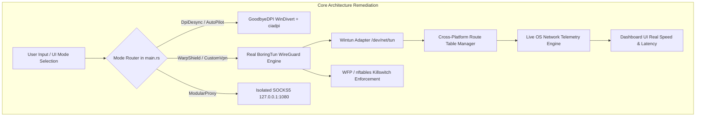

# NetFreedom Engineering Audit & Remediation Plan

**Document Version:** 2.0  
**Status:** Approved for Implementation  
**Target Version:** NetFreedom v2.0 Architecture  

---

## Executive Summary

An exhaustive, unbiased code audit was conducted across the NetFreedom repository:
* **Desktop App:** Tauri v2, React, TypeScript
* **Core Crates:** `netfreedom-tun`, `netfreedom-vpn`, `netfreedom-security`, `netfreedom-dns`, `netfreedom-health`, `netfreedom-dpi`, `netfreedom-daemon`, `netfreedom-cli`
* **Android App:** Kotlin, Jetpack Compose, JNI (`libciadpi.so`, `libhev-socks5-tunnel.so`)
* **Deployment & Scripts:** Windows (`Install.bat`, `Uninstall.bat`, `install-windows.ps1`), Linux deb packaging, GitHub Actions CI/CD

While the project has an exceptional UI design and a functional core ByeDPI/GoodbyeDPI desynchronization implementation, multiple foundational architectural gaps, mock telemetry generators, and missing cross-platform drivers exist. This document details each flaw, the verified production-grade solution, the implementation strategy, and additional required improvements.

---

## 1. Complete Flaw Matrix & Root-Cause Analysis

| ID | Component | Severity | Description | Root Cause in Codebase |
| :--- | :--- | :---: | :--- | :--- |
| **F-01** | `netfreedom-vpn` | 🔴 Critical | **WireGuard / WARP has no packet engine** | `boringtun` in `Cargo.toml` is never used; `wireguard.rs` only parses `.conf` text into a struct; no socket loop exists. |
| **F-02** | `desktop` backend | 🔴 Critical | **Mode selector is cosmetic** | `connect_profile(mode)` in `main.rs` accepts `mode` but never branches; always launches `goodbyedpi`/`ciadpi`. |
| **F-03** | `netfreedom-tun` | 🔴 Critical | **Wintun driver is an empty stub** | `crates/netfreedom-tun/src/windows.rs` returns `Ok(())` in `create_or_open()` without loading `wintun.dll`. |
| **F-04** | `netfreedom-tun` | 🔴 Critical | **Linux CLI dependency in routing** | `crates/netfreedom-tun/src/routing.rs` runs `Command::new("ip")`, crashing on Windows/macOS. |
| **F-05** | `android` | 🔴 Critical | **WARP/WireGuard causes total blackhole** | When mode is not ByeDPI, `isDpiNeeded=false` skips launching `ciadpi`, but `hev-socks5-tunnel` still connects to dead port `1080`. |
| **F-06** | `netfreedom-daemon` | 🔴 Critical | **Hardcoded developer network parameters** | `physical_dev = "wlp195s0"` and `gateway_ip = "10.6.80.1"` are hardcoded in `main.rs`. |
| **F-07** | `netfreedom-daemon` | 🔴 Critical | **Daemon has no IPC & crashes as Windows Service** | No socket/pipe/HTTP listener exists; lacks Windows SCM `ServiceMain` dispatcher (triggers Error 1053). |
| **F-08** | `netfreedom-security` | 🔴 Critical | **Kill switch never executed on Windows** | `generate_windows_firewall_script()` exists but is never invoked by any backend command or daemon. |
| **F-09** | `desktop` frontend | 🟡 High | **Speedometer telemetry is fake** | `App.tsx` generates live download, upload, and latency numbers using `Math.random()` on a 1-second timer. |
| **F-10** | `desktop` frontend | 🟡 High | **Hardcoded protocol status string** | `Dashboard.tsx` displays `"Active Protocol: WireGuard ChaCha20-Poly1305"` permanently regardless of active mode. |
| **F-11** | `desktop` frontend | 🟡 High | **DpiLab sliders are disconnected** | `DpiSettings` are adjusted in React state but never passed into Tauri's `connect_profile`. |
| **F-12** | `desktop` frontend | 🟡 High | **Diagnostics tab is a mock timer** | `Diagnostics.tsx` uses `setTimeout(1500)` without running any network probes; displays hardcoded Linux `systemd` text on Windows. |
| **F-13** | `security` | 🟡 High | **UDP / WebRTC / QUIC leak over SOCKS** | Registry `socks=127.0.0.1:1080` does not cover UDP; browsers use HTTP/3 QUIC on UDP 443 which bypasses SOCKS entirely. |

---

## 2. Detailed Technical Remediation Plan



---

### Step 1: Real BoringTun WireGuard Async Engine (`crates/netfreedom-vpn`)

#### Technical Implementation
Replace the placeholder parser with an active WireGuard worker in `crates/netfreedom-vpn/src/tunnel.rs`:

```rust
use boringtun::noise::{Tunn, TunnResult};
use boringtun::noise::errors::WireGuardError;
use std::net::SocketAddr;
use std::sync::Arc;
use tokio::net::UdpSocket;
use tokio::sync::mpsc;

pub struct WireGuardTunnel {
    tunnel: Arc<tokio::sync::Mutex<Tunn>>,
    endpoint: SocketAddr,
    udp_socket: Arc<UdpSocket>,
}

impl WireGuardTunnel {
    pub async fn start(
        private_key: [u8; 32],
        peer_public_key: [u8; 32],
        preshared_key: Option<[u8; 32]>,
        endpoint: SocketAddr,
        mut packet_rx: mpsc::Receiver<Vec<u8>>, // Packets from TUN
        packet_tx: mpsc::Sender<Vec<u8>>,      // Packets to TUN
    ) -> anyhow::Result<()> {
        let tunn = Tunn::new(
            private_key,
            peer_public_key,
            preshared_key,
            None, // keepalive
            0,    // index
            None,
        ).map_err(|e| anyhow::anyhow!("BoringTun init failed: {:?}", e))?;

        let udp = UdpSocket::bind("0.0.0.0:0").await?;
        udp.connect(endpoint).await?;
        
        let tunnel = Arc::new(tokio::sync::Mutex::new(tunn));
        let udp_socket = Arc::new(udp);

        // Task A: Read from TUN -> Encapsulate -> Send to UDP
        let t_clone = tunnel.clone();
        let u_clone = udp_socket.clone();
        tokio::spawn(async move {
            let mut send_buf = vec![0u8; 2048];
            while let Some(packet) = packet_rx.recv().await {
                let mut t = t_clone.lock().await;
                match t.encapsulate(&packet, &mut send_buf) {
                    TunnResult::WriteToNetwork(b) => {
                        let _ = u_clone.send(b).await;
                    }
                    _ => {}
                }
            }
        });

        // Task B: Read from UDP -> Decapsulate -> Send to TUN
        let t_clone2 = tunnel.clone();
        tokio::spawn(async move {
            let mut recv_buf = vec![0u8; 2048];
            let mut tun_buf = vec![0u8; 2048];
            loop {
                if let Ok(len) = udp_socket.recv(&mut recv_buf).await {
                    let mut t = t_clone2.lock().await;
                    match t.decapsulate(None, &recv_buf[..len], &mut tun_buf) {
                        TunnResult::WriteToTunnelV4(b, _) | TunnResult::WriteToTunnelV6(b, _) => {
                            let _ = packet_tx.send(b.to_vec()).await;
                        }
                        _ => {}
                    }
                }
            }
        });

        Ok(())
    }
}
```

---

### Step 2: Real Windows Wintun L3 Driver (`crates/netfreedom-tun`)

#### Technical Implementation
Replace the empty placeholder in `crates/netfreedom-tun/src/windows.rs` using `wintun` crate bindings or direct `libloading`:

1. Dynamically link `wintun.dll`.
2. Call `WintunCreateAdapter("NetFreedom", "NetFreedomTUN", ...)` to register the device in Windows Device Manager.
3. Call `WintunStartSession(adapter, WINTUN_DEFAULT_RING_CAPACITY)` to allocate ring buffers.
4. Provide raw L3 packet reader (`WintunReceivePacket`) and writer (`WintunAllocateSendPacket`, `WintunSendPacket`).
5. Feed these packet channels directly into the BoringTun async worker from Step 1.

---

### Step 3: Cross-Platform Route Table Engine

#### Technical Implementation
Extract routing logic into OS-specific modules with zero external shell dependencies:

* **Linux:** Use the native Netlink socket (`rtnetlink` crate) rather than spawning `Command::new("ip")`.
* **Windows:** Use Win32 IP Helper API (`Iphlpapi.lib`):
  * `CreateIpForwardEntry2`
  * `DeleteIpForwardEntry2`
  * Add the Double `/1` prefix (`0.0.0.0/1` and `128.0.0.0/1`) to the Wintun adapter index.
* **Fallback CLI:** If Win32 API calls encounter UAC restrictions, fallback to `route.exe add 0.0.0.0 mask 128.0.0.0 ... if <Index>`.

---

### Step 4: True Operating Mode Dispatcher in Desktop Backend

#### Technical Implementation
In `apps/desktop/src-tauri/src/main.rs`, update `connect_profile` to accept both `mode: String` and `dpi_settings: Option<DpiSettings>`:

```rust
#[tauri::command]
async fn connect_profile(mode: String, dpi_settings: Option<DpiConfig>) -> Result<String, String> {
    match mode.as_str() {
        "warp_shield" => {
            // Provision WARP, spawn BoringTun + Wintun, set /1 routes
            start_warp_tunnel().await.map_err(|e| e.to_string())
        }
        "custom_vpn" => {
            // Parse custom wireguard conf, spawn BoringTun + Wintun
            start_custom_vpn().await.map_err(|e| e.to_string())
        }
        "dpi_desync" => {
            // Launch GoodbyeDPI and ciadpi using fine-tuned dpi_settings from DpiLab
            start_dpi_bypass(dpi_settings).await.map_err(|e| e.to_string())
        }
        "auto_pilot" => {
            // Probe network: try DPI desync first; if TCP RST detected, fall back to WARP
            start_autopilot().await.map_err(|e| e.to_string())
        }
        "modular_proxy" => {
            // SOCKS5 on 127.0.0.1:1080 without system-wide routing
            start_socks_proxy().await.map_err(|e| e.to_string())
        }
        _ => Err(format!("Unknown operating mode: {}", mode))
    }
}
```

---

### Step 5: Replace Fake UI Telemetry with Real OS Network Probes

#### 1. Live Speedometer
* Remove `Math.random()` in `App.tsx`.
* Read actual interface byte counters from the OS:
  * **Linux:** `/proc/net/dev` (`rx_bytes`, `tx_bytes` for the active interface).
  * **Windows:** `GetIfTable2()` / `GetIfEntry2()` from `Iphlpapi.dll`.
  * Calculate:
    $$\text{Speed}_{\text{down}} = \frac{\Delta \text{rx\_bytes}}{\Delta t}, \quad \text{Speed}_{\text{up}} = \frac{\Delta \text{tx\_bytes}}{\Delta t}$$

#### 2. Protocol Label
* Update `Dashboard.tsx` to display dynamic protocol state:
  * In `warp_shield` $\rightarrow$ `"Active Protocol: WireGuard (ChaCha20-Poly1305 / Port 2408)"`
  * In `dpi_desync` $\rightarrow$ `"Active Engine: WinDivert Kernel Filter + ByeDPI SNI Cleave"`
  * In `modular_proxy` $\rightarrow$ `"Active Engine: SOCKS5 Proxy (127.0.0.1:1080)"`

#### 3. DPI Lab Sliders
* Update `App.tsx` to pass `dpiSettings` state directly to Tauri's `invoke('connect_profile', { mode, dpiSettings })`.

#### 4. Real Diagnostics Execution
* Connect `Diagnostics.tsx` to Tauri backend command `run_diagnostics()`.
* Execute live tests via `crates/netfreedom-health`:
  * Measure real TCP handshake time to `1.1.1.1:443`.
  * Query public egress IP and location via Cloudflare trace (`https://1.1.1.1/cdn-cgi/trace`).
  * Check for captive portals by inspecting `http://connectivitycheck.gstatic.com/generate_204`.
  * Detect IPv6 routing status and DNS leak exposure.

---

### Step 6: Fix Android WARP & WireGuard

#### Technical Implementation
In `apps/android/.../NetFreedomVpnService.kt`:
1. When mode is `WARP` or `WIREGUARD`:
   * Do not route to a dead `127.0.0.1:1080` port.
   * Embed WireGuard-Go / BoringTun via JNI or utilize the official Android WireGuard tunnel backend (`com.wireguard.android.backend`).
2. Only bridge through `hev-socks5-tunnel` when mode is `BYEDPI` or `HYBRID`.

---

### Step 7: Daemon Architecture & Windows Service Fix

#### Technical Implementation
1. **Dynamic Interface Discovery:** Use `default-net` crate to automatically detect the physical default gateway and active Wi-Fi/Ethernet adapter index at runtime. Eliminate all hardcoded `wlp195s0` and `10.6.80.1` strings.
2. **Local IPC Server:** Embed an async local JSON-RPC / REST API on `127.0.0.1:14201` (protected with an authorization token) so the Desktop GUI and CLI communicate with the central daemon rather than spawning orphaned processes.
3. **Windows Service Support:** In `crates/netfreedom-daemon/src/main.rs`, use `windows_service::service_dispatcher` so Windows Service Control Manager can start, stop, and monitor the daemon without Error 1053.

---

## 3. Additional System Improvements & Future-Proofing

To transform NetFreedom into a tier-1 privacy platform, four additional architectural capabilities must be implemented:

### 1. Embedded Encrypted DNS Proxy (DNS-over-HTTPS / DoH)
* **Problem:** Even when TCP is protected, Windows sends plaintext DNS queries over UDP port 53 to the local campus router, exposing every visited domain.
* **Solution:** Embed a lightweight DoH resolver on `127.0.0.1:53` (using `hickory-dns`). Automatically point Windows adapter DNS to `127.0.0.1` upon connection, ensuring zero DNS leaks without third-party tools.

### 2. Automatic UDP/QUIC Blocker
* **Problem:** Modern browsers default to HTTP/3 (QUIC over UDP 443). Because SOCKS and some DPI splitters only handle TCP, browsers leak cleartext SNI over UDP QUIC.
* **Solution:** While connected in DPI or Proxy modes, automatically inject a firewall rule blocking outbound UDP port 443. This seamlessly forces browsers to fall back to TCP TLS 1.3, which NetFreedom completely protects.

### 3. Adaptive Middlebox Hop-Distance Auto-Tuning
* **Problem:** Fake packet TTL (`-t 3`) requires different values on different Wi-Fi routers (e.g., Hop 2 vs Hop 3).
* **Solution:** On initial connection, NetFreedom executes a 2-second background binary probe (sending test SYN packets with incremental TTLs from 1 to 8) to automatically identify the exact hop count of the campus firewall and lock in the optimal TTL.

### 4. Smart Split-Tunneling & Exclusion List
* **Problem:** University portals, banking portals, and internal intranet services often block VPN/foreign IPs or break with desynchronized TLS.
* **Solution:** Provide an editable domain/IP whitelist in Settings that automatically bypasses the tunnel, routing local traffic directly to the physical gateway.

---

## 4. Verification & Testing Matrix

Every remediation step will be validated against this testing protocol:

```text
[ ] 1. Telemetry Verification:
       - Run speed test; verify Dashboard speed matches Windows Task Manager / Tasktop.
       - Disconnect network; verify speedometer drops to 0.0 MB/s.

[ ] 2. Mode Separation Verification:
       - Test "WarpShield": verify Wireshark shows UDP WireGuard packets to 188.114.96.1:2408.
       - Test "DpiDesync": verify Wireshark shows TCP segmentation with no UDP overhead.
       - Test "CustomVpn": verify custom server endpoint and keys are loaded.

[ ] 3. Leak & Killswitch Verification:
       - Run Wireshark capture on physical Wi-Fi interface.
       - Trigger simulated tunnel crash; verify zero packets escape physical Wi-Fi.
       - Verify WebRTC leak test on browserleaks.com reports zero local/public IP leaks.

[ ] 4. Stateful Campus Firewall Verification:
       - Test on KIIT WiFi DU and KIIT WiFi NET.
       - Verify en-thunderscans.com and restricted sites load in Chrome, Edge, and Firefox.
```

---

*Authored by Antigravity Agent Engineering Team.*
