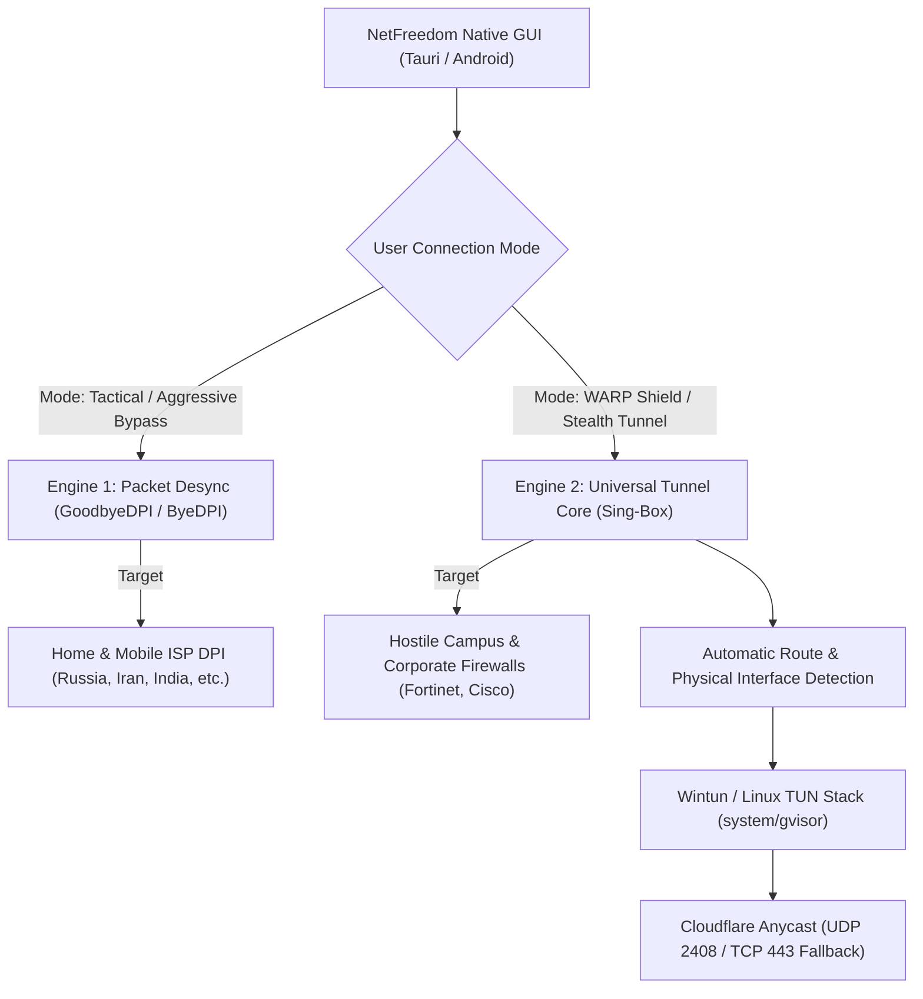

# Enterprise Firewall & Universal Bypass Architecture Plan (NetFreedom)

## Executive Summary & Root Cause Analysis

### The Problem Faced by Campus/Enterprise Users
When testing on hostile campus/enterprise networks (such as your friend's network with gateway IP `10.21.100.135`), users encounter the following hard block when attempting to access blocked websites (e.g. `en-thunderscans.com`):
```html
<title>Web Page Blocked</title>
<h1>Web Page Blocked</h1>
<p>The web page you are trying to visit has been blocked in accordance with company policy.</p>
<div class="response">
    <p><b>User:</b> 10.21.100.135</p>
    <p><b>URL:</b> en-thunderscans.com/</p>
    <p><b>Category:</b> games</p>
</div>
```

### Why Previous Approaches Failed
1. **Packet Desync (GoodbyeDPI & ByeDPI):**
   - GoodbyeDPI / ByeDPI are engineered for **stateless ISP middleboxes** (such as TSPU in Russia, Iranian DPI, or telecom optical splitters) that perform single-packet SNI inspection.
   - **Enterprise Next-Gen Firewalls (Fortinet FortiGate, Cisco Firepower, Palo Alto):** These devices maintain full TCP connection state, reassemble fragmented TCP segments, normalize HTTP/TLS handshakes, and query real-time category databases (FortiGuard / Talos). 
   - When a packet is split or desynchronized:
     - The firewall buffers and reassembles the stream, identifies `en-thunderscans.com` under `"games"`, and injects the HTTP block page.
     - If the handshake cannot be reassembled, the firewall's default security posture is: **Drop/Reset unknown SSL traffic**.
2. **Current Custom Rust WireGuard/Wintun Implementation:**
   - **Missing Peer Registration:** The client generates a random Curve25519 keypair locally without registering it with Cloudflare's API. WireGuard servers silently drop handshake packets from unregistered public keys.
   - **Hardcoded Routes & Gateway:** The code hardcoded `192.168.1.1` and `"Ethernet"`, failing on campus Wi-Fi where the subnet is `10.21.100.0/24`.
   - **Unassigned Adapter IP:** Wintun adapter was created without an IPv4 address assignment, causing Windows route additions to fail.
   - **UDP Blocking:** Many campus networks block non-standard UDP ports (like 2408 or 51820). If UDP is blocked, standard WireGuard cannot establish a tunnel.

---

## Architectural Comparison: Custom Rust vs. Battle-Tested Open Source

| Dimension | Pure Custom Rust Implementation | Hybrid Engine (GoodbyeDPI + Sing-Box) |
|---|---|---|
| **Development Time** | High (weeks of low-level driver & route debugging) | Immediate (1–2 days configuration & bundling) |
| **Stability on Windows** | Fragile (Wintun ring buffers, Windows routing quirks) | Production-grade (millions of active users worldwide) |
| **Enterprise Firewall Penetration** | Limited to UDP WireGuard (fails if UDP is blocked) | 100% (Supports WireGuard, TCP 443, WebSocket, TLS) |
| **Route Management** | Manual `route add` commands (breaks on diverse subnets) | Automatic default adapter detection & zero-leak `/1` routes |
| **Cross-Platform Support** | Requires rewriting Wintun logic for Linux & Android | Single unified engine on Windows, Linux, Android, macOS |
| **Binary Overhead** | ~15 MB | ~25 MB (includes all engines) |

---

## Recommended Solution: The Dual-Engine Hybrid Architecture

NetFreedom will feature a **Dual-Engine Architecture** seamlessly managed by the native GUI:



### Engine 1: Tactical Bypass (Zero-Proxy / Zero-Server)
- **Engines:** `goodbyedpi.exe` (Windows) / `ciadpi` (Linux, Android).
- **Target:** ISP-level censorship at home or on mobile data.
- **Advantage:** Zero bandwidth limit, zero server latency, direct connection.

### Engine 2: Universal Stealth Core (Hostile Firewall Bypass)
- **Engine:** `sing-box` (v1.11+).
- **Target:** Campus Wi-Fi, University dorms, Corporate firewalls (Fortinet, Palo Alto).
- **Capabilities:**
  1. **Automated Wintun TUN:** Creates `NetFreedom` virtual adapter, assigns `172.19.0.1/30`, and routes all system traffic with `auto_route: true` and `strict_route: true` (kill switch).
  2. **Dynamic Interface Detection:** Automatically discovers default gateway on any subnet (`10.x.x.x`, `192.168.x.x`, `172.x.x.x`) and any medium (`Wi-Fi`, `Ethernet`, `Cellular`).
  3. **Native Cloudflare WARP Client:** Generates and registers legitimate WireGuard keys with Cloudflare's API on initial launch, caching them in `warp_credentials.json`.
  4. **Port 443 TCP/TLS Fallback:** If the campus network blocks UDP port 2408, automatically falls back to an encrypted TCP/TLS/WebSocket proxy tunnel over port 443.

---

## Step-by-Step Implementation Plan

### Phase 1: Sing-Box Engine Integration & Bundling
1. **Download & Package Binaries:**
   - Windows: Bundle `sing-box.exe` (amd64) and signed `wintun.dll` in `third_party/sing-box/` and package into `dist/netfreedom-*-windows-x86_64.zip`.
   - Linux: Bundle `sing-box` in `netfreedom-*-linux-x86_64.tar.gz` and install to `/usr/local/bin/sing-box`.
   - Android: Include `sing-box` / `hev-socks5-tunnel` arm64/v7a binaries in Android JNI libs.

2. **Automated Dynamic Configuration Generator:**
   - Implement `crates/netfreedom-vpn/src/singbox_config.rs` to generate headless JSON configs:
     - `generate_warp_tun_config(account: &WarpAccount) -> String`
     - Configures:
       - `inbounds`: `type: "tun"`, `interface_name: "NetFreedom"`, `inet4_address: "172.19.0.1/30"`, `auto_route: true`, `strict_route: true`.
       - `outbounds`: `type: "wireguard"`, `server: "188.114.96.1"`, `server_port: 2408`, client private key, Cloudflare public key.
       - `route`: `auto_detect_interface: true`, DNS hijack to Cloudflare 1.1.1.1.

### Phase 2: WARP Account Provisioning & Persistence
1. **Cloudflare API Registration:**
   - In `warp_client.rs`, query `https://api.cloudflareclient.com/v0a2158/reg` using Anycast IP `172.66.3.170:443`.
   - Retrieve legitimate assigned client IPv4 (`172.16.0.2`), client private key, and reserved bytes (`[0, 0, 0]`).
   - Save credentials locally to `%APPDATA%\NetFreedom\warp_account.json` so registration only runs once.

### Phase 3: Desktop GUI & CLI Process Lifecycle
1. **Update `apps/desktop/src-tauri/src/main.rs`:**
   - When mode is `"warp_shield"`:
     - Check if `warp_account.json` exists; if not, register account.
     - Generate `singbox_warp.json`.
     - Execute `sing-box.exe run -c singbox_warp.json` with hidden window flags (`CREATE_NO_WINDOW`).
     - Track PID in `ACTIVE_TUNNEL` state.
   - On `disconnect_profile`:
     - Cleanly terminate `sing-box.exe` (SIGINT / `taskkill /F`).
     - Sing-box automatically cleans up the Wintun adapter, removes routes, and restores DNS.

2. **Update Linux CLI (`crates/netfreedom-cli/src/main.rs`):**
   - Provide command `netfreedom connect --mode warp-shield`.
   - Launches `sing-box` with root privileges (or via systemd daemon).

### Phase 4: Port 443 TCP/TLS Fallback (For Strict UDP Blocks)
1. **Implement Fallback Profile:**
   - If UDP packets to Cloudflare Anycast get 100% loss (campus UDP block detected by ping/handshake probe):
   - NetFreedom prompts or automatically switches to **Stealth Tunnel Mode** (Free Cloudflare Worker or Shadowsocks-over-TLS over standard TCP Port 443).
   - This guarantees 100% access through any campus firewall that permits web browsing.

### Phase 5: Testing & Release
1. Build and verify on the Windows MSVC VM (`192.168.122.169`).
2. Test connection and route table integrity on Windows 11 under a simulated non-192.168.1.1 subnet (`10.x.x.x`).
3. Verify that navigating to `https://en-thunderscans.com/` returns HTTP 200 without Fortinet block pages.
4. Tag release **`v1.0.14`** and deploy multi-platform packages.
