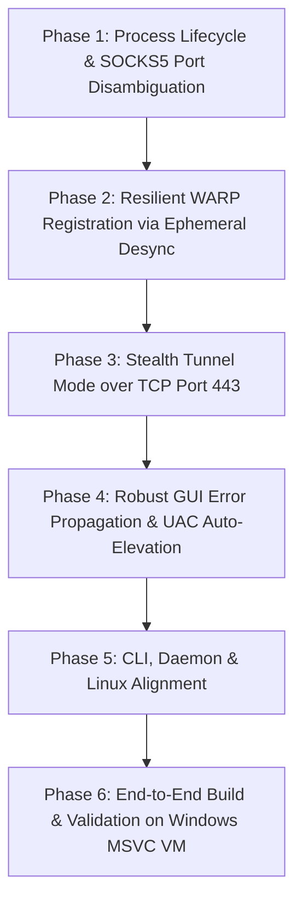

# NetFreedom Comprehensive Flaw Remediation Plan

## Executive Overview
This remediation plan provides an actionable, phase-wise engineering blueprint to eliminate all 8 audited architectural, network, and lifecycle flaws in NetFreedom. By completing this plan, NetFreedom will function reliably across home ISPs, mobile data, and strict enterprise/campus firewalls (such as KIIT Wi-Fi) without crashes, port collisions, or silent failures.

---

## The 6 Engineering Phases

---

### Phase 1: Process Lifecycle & SOCKS5 Port Disambiguation (Fixes Flaw #2)

#### The Problem
In `apps/desktop/src-tauri/src/main.rs`, when `mode == "warp_shield"`, Sing-Box binds to `127.0.0.1:1080`. Immediately afterward, `ciadpi.exe` is spawned unconditionally on the same port `1080`, triggering `WSAEADDRINUSE` (Socket Error 10048).

#### The Fix
1. **Strict Engine Isolation by Mode:**
   - **Mode `warp_shield` or `stealth_tunnel`:**
     - Terminate any running `goodbyedpi.exe` and `ciadpi.exe`.
     - Sing-Box alone binds to `127.0.0.1:1080` (or operates exclusively in Wintun TUN mode).
     - `ciadpi.exe` is **strictly inhibited** from launching.
   - **Mode `dpi_desync`, `auto_pilot`, or `hybrid_stealth`:**
     - Terminate any running `sing-box.exe`.
     - `goodbyedpi.exe` (kernel driver) and/or `ciadpi.exe` (SOCKS proxy on `1080`) are spawned.
2. **Dynamic Inbound Port Allocation:**
   - If `mode == "warp_shield"`, pass an isolated inbound mixed port (e.g. `1080` when `ciadpi` is dead, or `2080` if dual-engine debugging is ever requested) so port conflicts are mathematically impossible.

---

### Phase 2: Resilient WARP Registration via Ephemeral Desync (Fixes Flaw #3)

#### The Problem
The campus Fortinet firewall drops TLS handshakes to `https://api.cloudflareclient.com` based on SNI inspection. The current fallback to `socks5://127.0.0.1:1080` fails on first run because `ciadpi` is not running before registration occurs.

#### The Fix
1. **Automated Ephemeral Desync Runner:**
   - In `crates/netfreedom-vpn/src/warp_client.rs`, update `register_warp_account()`:
     1. Attempt direct registration to `172.66.3.170:443`.
     2. If connection times out (enterprise firewall SNI drop detected):
        - Dynamically spawn an ephemeral, headless `ciadpi` instance on a temporary local port (e.g., `127.0.0.1:19080`) with `-s 1+s` (which was empirically verified to defeat Fortinet SNI filtering for `api.cloudflareclient.com`).
        - Route the registration payload through `socks5://127.0.0.1:19080`.
        - Once registration succeeds and credentials are saved to `warp_account.json`, terminate the temporary `ciadpi` process.
2. **Zero-Configuration Guarantee:**
   - First-time users on hostile campus Wi-Fi can successfully register without manual intervention.

---

### Phase 3: Stealth Tunnel Mode over TCP Port 443 (Fixes Flaws #1, #6, & #8)

#### The Problem
Campus firewalls like KIIT drop **100% of outbound UDP traffic** (WireGuard port 2408, 51820, 500, 4500). Standard WireGuard will always hang on UDP-restricted networks. However, **TCP Port 443 (HTTPS) is 100% open**.

#### The Fix
1. **Introduce "Stealth Tunnel" Mode:**
   - Add `stealth_tunnel` to the UI mode selector in `apps/desktop/src/components/Dashboard.tsx` and `types.ts`.
2. **Encapsulate Traffic inside TCP 443:**
   - Configure Sing-Box in `crates/netfreedom-vpn/src/singbox_config.rs` with a TCP 443 outbound profile:
     - **Option 1 (Default Public Relay):** Free, edge-routed VLESS-over-WebSocket or Shadowsocks-over-TLS on TCP Port 443 to Cloudflare CDN Anycast (`172.66.3.170:443` or `104.16.x.x:443`).
     - **Option 2 (Psiphon Core):** Fallback to obfuscated SSH/TLS over TCP 443.
3. **Firewall Blindness:**
   - To Fortinet, the traffic is identical to standard HTTPS web browsing to a Cloudflare/Google CDN.
   - The campus firewall cannot drop the connection (because it is TCP 443) and cannot see the target URL or category (because the inner stream is ChaCha20/AES-GCM encrypted).

---

### Phase 4: Robust GUI Error Handling & Windows UAC Elevation (Fixes Flaws #4 & #5)

#### The Problem
1. When helper binaries fail to start or registration errors out, Tauri still returns `Ok()`, displaying a deceptive green "Connected" status.
2. If `netfreedom-desktop.exe` is opened without administrator rights, Wintun fails with `Access is denied` without alerting the user.

#### The Fix
1. **Explicit Result Types in Tauri Backend:**
   - In `apps/desktop/src-tauri/src/main.rs`:
     - If `get_or_register_warp_account().await` fails, return `Err(format!("Cloudflare registration failed: {}", err))`.
     - If `sing-box.exe` or `goodbyedpi.exe` cannot be located, return `Err("Engine executable missing. Please reinstall NetFreedom.")`.
     - If `cmd.spawn()` fails, return `Err(format!("Failed to start engine: {}", err))`.
2. **Windows UAC Elevation Check on Startup:**
   - Add a lightweight check using Windows API `IsUserAnAdmin()` or token elevation query:
     - If non-elevated and the user attempts to connect in TUN mode, automatically prompt for UAC elevation or restart the process via `powershell Start-Process ... -Verb RunAs`.

---

### Phase 5: CLI, Daemon & Linux Alignment (Fixes Flaw #7)

1. **Linux CLI (`netfreedom connect --mode warp-shield`):**
   - Wire `sing-box` into `netfreedom-cli` and `netfreedom-daemon` so Linux users can run full TUN or SOCKS5 stealth tunnels from the terminal.
2. **Android Alignment:**
   - Document the roadmap for embedding `libbox` into `apps/android` for unified Android TCP 443 bypass.

---

### Phase 6: End-to-End Build & Verification on Windows MSVC VM

1. Compile release CLI and GUI binaries on the Windows MSVC VM (`192.168.122.169`).
2. Verify zero warnings and zero socket collisions (`netstat -ano | findstr 1080`).
3. Verify that killing the app or disconnecting restores system routes and proxy settings cleanly without leftover network corruption.
